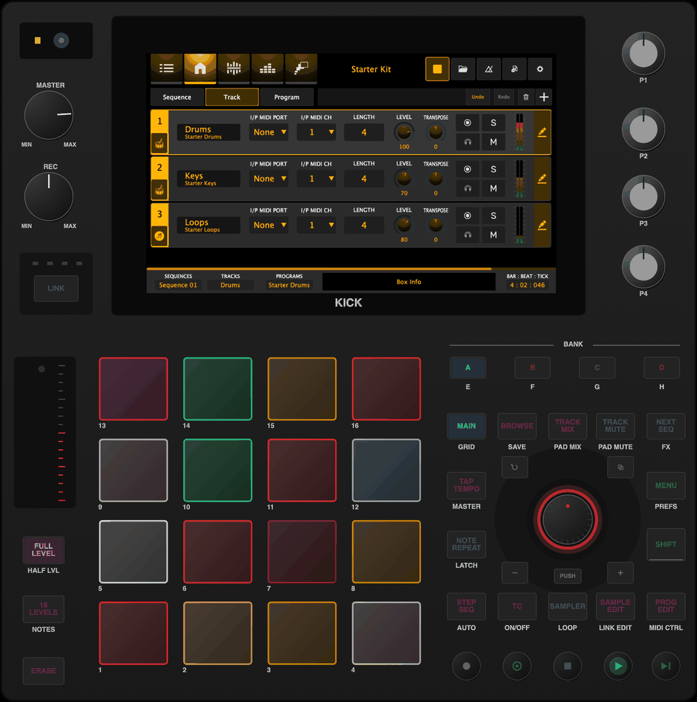
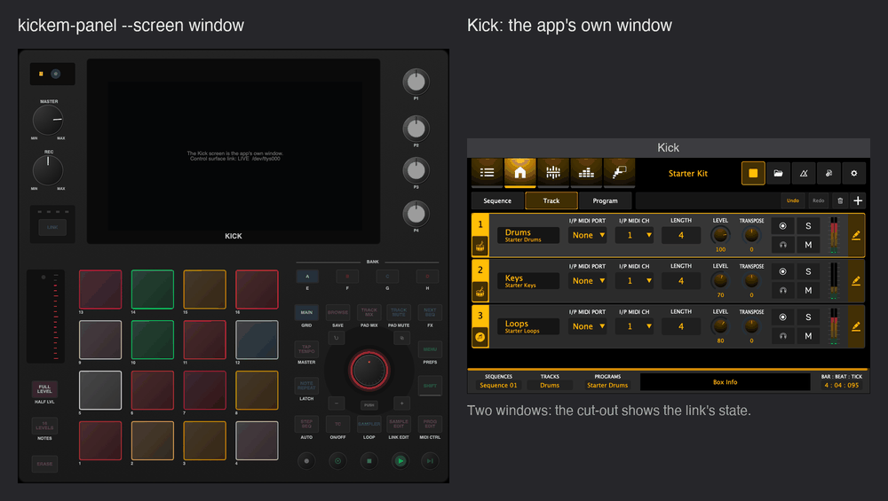
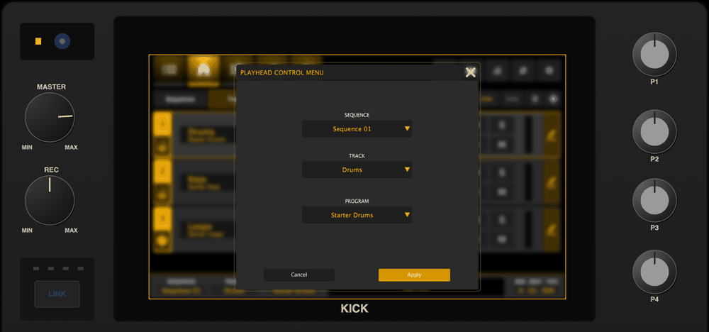
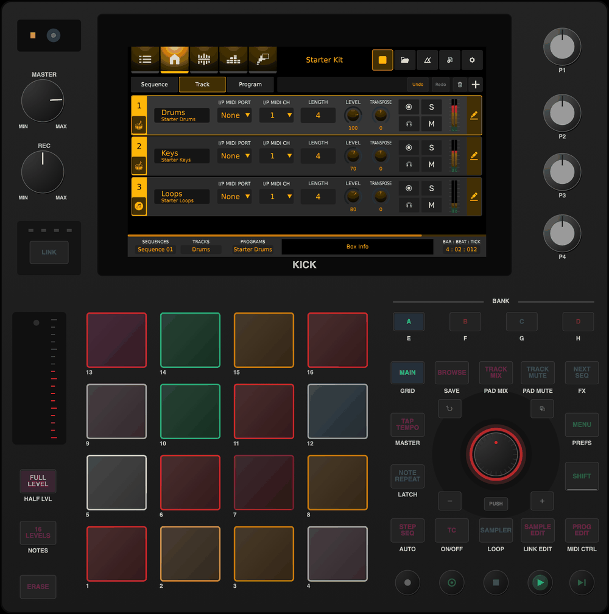

# KickEmulator

A desktop emulator for the Behringer Kick firmware (`0700-AAM`) and any fork of it. You give it a
firmware repository URL and a branch. It fetches that ref, builds it, and runs it against an
emulated front panel, so you can test a change to the Kick app, the audio engine or the Linux
image without a unit.

> **Status:** fast mode runs on macOS (Apple Silicon), and all seven checks (smoke, transport,
> modes, pads, sampler_looper, overlays, serial_faults) pass over the wire against
> `integration/standalone`.
> Faithful mode (the fork's Linux arm64 build in a QEMU VM) runs and its smoke test passes too.
> The other checks and CI come next; see [Status](#status). The plan is
> `/goal-standalone` on the firmware work branch `rbdone/goal-simulator-controls`
> (`.claude/commands/goal-standalone.md`).



*Fast mode, `--screen embedded` (the default): the fork's own `Kick` app, its screen inside the
panel's bezel, playing the Starter Kit. Clicks and drags on the screen are touches.*

The firmware itself needs no emulator code. The only coupling is the control-surface serial
protocol (`CPktMgr`, `ComProtocol/PktMgr`). The panel is a separate program that speaks the
microcontroller's side of that protocol over a transport: a pseudo-terminal, a TCP socket, or a
real serial port. The protocol headers and control ids (`ComProtocol/PktMgr`,
`Kick/modules/contracts/dcl`) come from the firmware ref under test, not from a copy, so a fork
that extends the protocol still works.

## Quick start (macOS)

Needs Xcode's command-line tools, CMake 3.22+, git and Python 3.8+.

```sh
git clone https://github.com/KickEm-Tools/KickEmulator.git && cd KickEmulator
./kickem run --ref feature/screen-mirror         # fetch, build, start the panel and Kick, connect them
```

One window opens: the panel, with the Kick's screen (the fork's own `Kick` app) inside it. On the
Projects screen, press **PUSH** on the panel to load the Starter Kit, then **PLAY** (the round green
key). Click or drag on the screen as you would touch the unit's. Ctrl-C in the terminal stops both.
`--screen window` gives the app its own window instead, as before. The first run downloads JUCE (about 170 MB) into
`~/.cache/kickem/cpm` unless `CPM_SOURCE_CACHE` points at a cache that has it.

`feature/screen-mirror` is `KickEm-Tools/0700-AAM` `main` plus the opt-in screen mirror that the
embedded screen needs in fast mode (pull request #23, in review). Any other ref works as well; one
without the mirror runs with the screen in its own window, and `kickem` says so (see
[Pointing it at your fork](#pointing-it-at-your-fork)).

**How long it takes** (Apple Silicon, 16 cores, JUCE already in the CPM cache), measured by
`checks/smoke` from a cold cache on 2026-10-28:

| Step | Time |
|---|---|
| fetch (shallow clone) | 8 s |
| first build: `Kick` 114 s, panel 14 s | 128 s |
| from the end of the build to the handshake | 2.4 s |
| from the end of the build to sound out of the Starter Kit | 7.3 s, including the smoke test's 2 s pause after loading (target: 30 s) |

## Modes

Both modes use the same panel and the same checks.

| | Fast mode (`--mode fast`) | Faithful mode (`--mode vm`) |
|---|---|---|
| Runs | The fork's `Kick` app, built for the desktop (macOS, Linux) from the fork's source and connected to the panel over a pty | The fork's Linux arm64 `KT_Kick` build in a QEMU arm64 VM, with the panel on the VM's serial port |
| For | Quick edits and rebuilds, a debugger, scripted checks | The device's Linux code paths and services; CI on firmware pull requests |
| Needs in the firmware | It builds on the desktop, has a working serial port, and has a few generic, opt-in extension points (`KICK_SERIAL_DEVICE`, `KICK_TEST_CONTROL`, `KICK_AUDIO_PROBE`, ...) | A working serial port |
| State | works on macOS; Linux desktop not tried | works on macOS (Apple Silicon, hvf; TCG too); Linux hosts not tried |

### The screen: embedded or in its own window

`--screen embedded` (the default) puts the Kick's 1024x600 screen in the panel's display cut-out.
It scales with the panel when the window is resized, and a click, a drag or a held press on it is
a touch on the unit's screen: list rows, buttons, knobs, sliders and the popups and dialogs drawn
over them. `--screen window` keeps the screen out of the panel: the app's own window in fast mode,
and QEMU's display window with `--display` in faithful mode (headless without it).

| | Fast mode | Faithful mode |
|---|---|---|
| Embedded: where the screen comes from | The app itself, started with `KICK_SCREEN_MIRROR=<unix socket>`: its window then has no native window; JUCE paints it with the software renderer (as on the unit) and the app serves it over RFB ("VNC"), at most 30 frames a second, only what changed | QEMU's own VNC server on the VM's display (`-vnc unix:<socket>`); no firmware change |
| Embedded: where a click goes | Over the socket to the app's window peer, which hands it to JUCE as a native window's mouse events: JUCE dispatches it as a touch | Over the socket to QEMU, which moves the VM's `usb-tablet` (absolute) and presses it; Weston and Xwayland deliver it to the app |
| Embedded: what it needs in the firmware | `KICK_SCREEN_MIRROR` (`feature/screen-mirror`, PR #23); without it `kickem` falls back to window mode and says so | nothing |
| Window | The app's own window (`touch` from the test-control module needs it topmost) | QEMU's window with `--display`, else headless |

The embedded screen uses no operating-system input: it works with the Mac locked or the panel
covered, and nothing of the app appears on the desktop (no window, no Dock icon). Scripts click
it through the panel (`kickem_ctl screentouch X Y`, the same path as the mouse) and read what the
panel shows (`kickem_ctl screenshot`, `kickem_ctl screen` for the frame rate and the
touch-to-frame latency). `checks/embedded_screen` proves a click selects a list row and opens a
dialog, and that the dialog shows inside the embedded screen.

| Window mode, fast: the panel and the app's own window | Embedded, a dialog opened by a click on the screen |
|---|---|
|  |  |



*Faithful mode, `--screen embedded`: the fork's Linux arm64 `KT_Kick` in the QEMU VM, its display
(Weston and Xwayland at 1024x600) in the panel through QEMU's VNC server.*

**Measured** (Apple M4 Max, 2026-10-29, `checks/embedded_screen` and `checks/smoke`; `kickem_ctl
screen` reports the same numbers on a running emulator):

| | Fast mode (screen mirror) | Faithful mode (QEMU VNC, hvf) |
|---|---|---|
| Updates while the transport plays (BAR:BEAT:TICK, meters) | 29.2-29.3 per second (the mirror's cap is 30) | 29.3 per second |
| Updates on a still screen | none (only changed areas are sent) | none |
| Click to the first changed frame | 6-8 ms (list row), at most 32 ms | 80-175 ms (QEMU, Weston, Xwayland and the app in the VM) |
| Data on the socket over a smoke run (load, eight seconds of playing) | 26 MB (changed rectangles, raw) | 54 MB |
| CPU while playing | Kick about 11 %, the panel about 7 % of one core | |

These are the emulator's numbers, not the unit's: the unit's own display path has no socket in
it.

## What each mode cannot tell you

- **Fast mode** runs the desktop build, not the device's Linux build. It cannot tell you anything
  Linux-specific: systemd units, scripts, device nodes, and the Wi-Fi / Ethernet / CV /
  firmware-update screens, which show as "not available on this system". Timing, latency and CPU
  load are your computer's, not the unit's A53 cores. The panel is an emulation of the
  microcontroller's protocol, not its firmware.
- **Faithful mode** cannot tell you latency, CPU headroom on the A53 cores, the codec, the GPU
  driver, or the control-surface microcontroller's own behaviour.

`kickem run` and every check print this at the start.

## Faithful mode (`--mode vm`)

```sh
brew install qemu                                             # once; Docker Desktop is needed too
./kickem run --mode vm --ref integration/standalone           # Ctrl-C stops the VM and the panel
checks/smoke --mode vm --ref integration/standalone
```

The first run builds `KT_Kick-linux-arm64` from the ref in a Debian 12 arm64 container, downloads
the stock Debian 12 arm64 cloud image and provisions it once with cloud-init (into
`~/.cache/kickem/vm`, never into a repository). Every run then boots a fresh overlay of that
image in QEMU (`virt`, `-accel hvf` on Apple Silicon), deploys the artifact, the Starter Kit and
the fork's own `ktkick.service` / `kt_kick.sh` / Weston files to the unit's paths, attaches the
panel to the guest's UART (`/dev/ttyAMA0`, on a pty here), and starts `ktkick.service`.
`KICK_HARDWARE` is left unset, so the Linux code for Ethernet, Wi-Fi, the clock and the backlight
runs for real. Screen touches and screenshots go through QMP. Details, the VM's hardware and what
ran for real: [`modes/vm/README.md`](modes/vm/README.md).

**How long it takes** (Apple M4 Max, measured by `checks/smoke --mode vm` on 2026-10-29, without
the time spent waiting for another emulator's lock):

| Step | hvf | TCG on the same Mac (emulation speed) |
|---|---|---|
| Provision the image (once) | 95-112 s | |
| Boot, QEMU start to SSH | 12.3 s | 19.5 s |
| Deploy | 1.1 s | 15.3 s |
| `ktkick.service` to LIVE (includes `kt_kick.sh`'s 15 s sleep) | 16.1 s | 22.4 s |
| `kickem run` to LIVE, artifact built | 30.4 s | 59.2 s |
| Whole smoke test, artifact built | about 51 s | about 97 s |

On an x86 Linux runner (TCG) expect roughly 2-4 times the TCG column; that is an estimate, not
a measurement (`modes/vm/README.md`, Timing). The fork's CI artifact (built on Ubuntu 24.04,
glibc 2.39) does not start in the Debian 12 guest, so faithful mode builds its own; see
`modes/vm/README.md`.

## Usage

```sh
./kickem fetch [--firmware URL|PATH] [--ref REF]     # clone or update into ~/.cache/kickem/firmware
./kickem build [--firmware URL|PATH] [--ref REF]     # fetch, build Kick and the panel, install the Starter Kit
./kickem run   [--firmware URL|PATH] [--ref REF] [--mode fast|vm] [--screen embedded|window] [--detach]
               [--fresh] [--probe OUT.wav] [--throttle [BAUD]] [--no-build] [--out DIR]
./kickem stop                                        # stop a --detach run, release the lock
./kickem status
```

- `--firmware` defaults to `https://github.com/KickEm-Tools/0700-AAM.git`; a local repository path
  works too. `--ref` is a branch, a tag or a full commit SHA (default `main`).
- `--fresh` restores the build's `demos/` and `templates/` from the checkout and drops `prefs/`,
  so saves and recent projects from an earlier run do not leak in.
- `--probe OUT.wav` sets `KICK_AUDIO_PROBE`: the app writes its master output there and logs
  `AudioProbe: t=<n>s peak=<x>dBFS rms=<y>dBFS` each second.
- `--screen embedded` (default) shows the Kick's screen inside the panel; `--screen window` gives
  it its own window (fast) or QEMU's window with `--display` (vm). See
  [The screen](#the-screen-embedded-or-in-its-own-window).
- `--throttle` paces the panel's link at the unit's 230400 baud.
- `KICK_AUDIO_INPUT` defaults to `silence` (no path from the microphone to the speakers); set it to
  `device` for the real input.
- Environment: `KICKEM_CACHE` (default `~/.cache/kickem`), `CPM_SOURCE_CACHE` (default
  `<cache>/cpm`), `KICKEM_LOCK` (default `/tmp/kt_kickem.lock`), `KICKEM_LOCK_WAIT` (default 1800 s).

Logs of a run are in `~/.cache/kickem/run` (or `--out`): `kick.log` (the app: `InputEvents:`,
`Send Comm Live`, `Project: loaded`, `AudioProbe:`, `TestControl:`) and `panel.log` (the panel:
`SimSerial:` for every frame in both directions, with hex; `SimSurface:` with
`KICK_SIM_LOG_SURFACE=1`; `PanelControl:`). `checks/lib/kickem_ctl` drives a running emulator from
scripts: panel keys over the wire, the screen through the firmware's test-control file
(`checks/README.md`).

**One instance per machine.** The app is single-instance and the emulator assumes one audio
device and one panel. `run` holds a machine-wide lock, `/tmp/kt_kickem.lock`: a directory with the
owner's pid (the running app's, once started), in the same format as the in-tree simulator's
`sim_launch.sh`, so the two never run at once. It also waits while any `Kick` or `KT_KickEM`
process runs without the lock. A lock whose owner has died is reclaimed; otherwise `run` waits.

## Pointing it at your fork

```sh
./kickem run --firmware https://github.com/<you>/0700-AAM.git --ref <your-branch>
./kickem run --firmware ~/src/0700-AAM --ref <your-branch>     # a local clone: commit first, it fetches the branch
checks/smoke --firmware ~/src/0700-AAM --ref <your-branch>
```

Fast mode needs these changes in the fork. Until they are merged into `KickEm-Tools/0700-AAM`
`main`, base your branch on `integration/standalone` or merge them yourself:

| Needed for | Branch (pull request) | Without it |
|---|---|---|
| building at all: reconstructed `AudIO_juce`, `AudIO_constants`, build fixes | `build/release-builds` (#1) | `kickem` stops before building |
| the panel's link: a real `juce_serialport`, `KICK_SERIAL_DEVICE` | `feature/serialport` (#15) | `kickem` stops before building |
| screen commands (`KICK_TEST_CONTROL`), audio probe and test input, `KICK_HARDWARE` | `feature/desktop-seams` (#2) | warning; checks that need them fail |
| the Starter Kit's samples (relative sample paths) | `fix/relative-sample-paths` (#7) | warning |
| SHIFT functions from a control surface | `fix/shift-state` (#16) | SHIFT + key behaviours do nothing (as on a unit today) |
| the screen inside the panel (`--screen embedded`, fast mode) | `feature/screen-mirror` (#23) | the screen is the app's own window, with a message |

`kickem` checks the fetched tree for these before building and names what is missing. Against
`KickEm-Tools/0700-AAM` `main` (`27194180`, equal to upstream) today it says the first two are
missing; with `--ignore-missing` the configure fails, because CPM tries to clone `AudIO` from the
placeholder server `https://example.com/your-git-server`.

## Status

| Phase (`/goal-standalone`) | What | State |
|---|---|---|
| 4 | This repository: licence, layout, the firmware fetch, protocol targets from the fetched ref, `protocol_roundtrip`, the Starter Kit, `kickem fetch` | done |
| 5a | The panel as its own program on the wire (pty, tcp, serial, throttle); `kickem run --mode fast`; the panel control channel and `kickem_ctl`; `checks/smoke` | done: smoke passes against `integration/standalone` |
| 5b | `checks/transport`, `modes`, `pads`, `sampler_looper`, `overlays` (ports of the in-tree `sim_*.sh`) and `serial_faults` (/goal-serial phase 5); panel fault injection (`raw`, `split`, `close`, `reopen`) | done: all pass against `integration/standalone` (2026-10-29); the fault test found the reader bugs fixed in KickEm-Tools/0700-AAM #17; drift against `main` in `checks/README.md` |
| 6 | Faithful mode: QEMU arm64 VM with the fork's `KT_Kick-linux-arm64`, panel on the VM's serial port | done: `kickem run --mode vm`, `checks/smoke --mode vm` passes (hvf and TCG) against `integration/standalone` |
| 7 | Reusable CI workflow for forks (`test-firmware.yml`), panel release builds | in progress |
| - | The embedded screen (`--screen embedded`): the firmware's `KICK_SCREEN_MIRROR` in fast mode, QEMU's VNC server in faithful mode; `checks/embedded_screen` | done, see [The screen](#the-screen-embedded-or-in-its-own-window) |

## Layout

| Path | What |
|---|---|
| `panel/` | The front panel, `kickem-panel`, and its embedded screen (`ScreenView`, an RFB client); see `panel/README.md` |
| `transport/` | pty, TCP and serial transports for the panel, and the throttle |
| `cmake/` | `KickemFirmware.cmake`: fetches the firmware by URL and ref, and exposes the protocol targets |
| `tools/protocol_roundtrip/` | Encodes and decodes packets with the fetched ref's `CPktMgr`, as the app's serial reader does |
| `modes/fast/` | How fast mode builds and runs a fork (it lives in `kickem`) |
| `modes/vm/` | Faithful mode: `kickem_vm.py` (image, provisioning, boot, deploy, QMP), `artifact.sh`, `guest/`, `run.sh` |
| `checks/` | `smoke`, `transport`, `modes`, `pads`, `sampler_looper`, `overlays`, `serial_faults`, `embedded_screen`; `lib/` (`kickem_ctl`, `common.sh`, `wav_measure.py`, `row_highlight.py`, `png_diff.py`). See `checks/README.md` |
| `content/StarterKit/` | The Starter Kit: synthesised samples and a demo project, CC0 |
| `kickem` | The launcher |
| `.github/workflows/` | Empty until phase 7 |

## Building the tools by hand

```sh
export MACOSX_DEPLOYMENT_TARGET=12.0                  # macOS: the firmware's JUCE needs it
cmake -S . -B build                                   # protocol_roundtrip only; fetches KickEm-Tools/0700-AAM main
cmake -S . -B build -DKICKEM_FIRMWARE_DIR=/path/to/0700-AAM -DKICKEM_PROTOCOL_JUCE=juce   # also the panel
cmake --build build && ./build/tools/protocol_roundtrip/protocol_roundtrip
```

See `cmake/README.md` for the options, including how the JUCE include in `dcl_contracts.h` is
satisfied.

## Content and branding

- **Starter Kit.** `content/StarterKit/` is synthesised from scratch by `make_starter_kit.py`
  (fixed seeds, Python standard library only) and is dedicated to the public domain under CC0 1.0,
  generator included. Its `LICENSE` sits beside it. Running the script reproduces the committed
  files byte for byte. `kickem` installs it into the build's data paths
  (`content/StarterKit/README.md`).
- **No logo.** The emulator draws no manufacturer logo or other trademarks: the area above the
  screen, where the unit carries its logo, is left blank. The model name under the screen stays.
- **Screenshots** in `docs/images/` are the panel's and the app's own renders (`kickem_ctl
  panelshot`, `shot`, `screenshot`), not desktop captures.
- Never committed: firmware build outputs, VM disk images, Buildroot downloads, NXP firmware or
  driver blobs (see `.gitignore`).

## History

This repository started clean. The simulator was developed inside the firmware tree on
`rbdone/0700-AAM`, branch `rbdone/goal-simulator-controls`. The import commit names the source
commit (`6b6024ce`) and maps every imported file to its path there. That branch keeps the full
history and the audit record (`docs/sim_audit/`, `docs/DEVELOPMENT.md` sections 4 and 7).

## Licence

GNU Affero General Public License v3.0 or later (`AGPL-3.0-or-later`), the same as the firmware it
builds against. See `LICENSE`. The Starter Kit content is CC0 1.0 (`content/StarterKit/LICENSE`).
