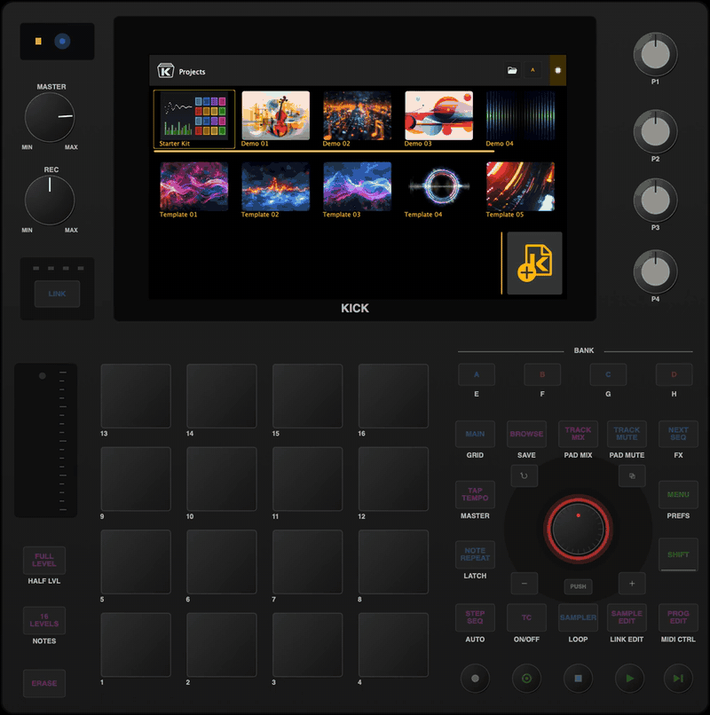

# KickEmulator

A desktop emulator for the Behringer Kick firmware (`0700-AAM`) and any fork of it. You give it a
firmware repository URL and a branch. It fetches that ref, builds it, and runs it against an
emulated front panel, so you can test a change to the Kick app, the audio engine or the Linux
image without a unit.

> **Status:** fast mode runs on macOS (Apple Silicon), and all seven checks (smoke, transport,
> modes, pads, sampler_looper, overlays, serial_faults) pass over the wire against
> `integration/standalone`.
> Faithful mode (the fork's Linux arm64 build in a QEMU VM) runs and its smoke test passes too.
> CI: a reusable workflow forks call with a few lines ([Add it to your fork's CI](#add-it-to-your-forks-ci)),
> and downloadable panel builds ([Panel downloads](#panel-downloads)); see [Status](#status). The plan is
> `/goal-standalone` on the firmware work branch `rbdone/goal-simulator-controls`
> (`.claude/commands/goal-standalone.md`).

[](docs/media/kickem-demo.mp4)

*Fast mode, `--screen embedded` (the default): the fork's own `Kick` app, its screen inside the
panel's bezel, loading and playing the Starter Kit. With sound:
[`docs/media/kickem-demo.mp4`](docs/media/kickem-demo.mp4) (33 s, H.264 + AAC; GitHub does not
play a repository's videos inline, so the link opens its player). Both are made by
[`docs/make_demo_video.sh`](docs/make_demo_video.sh): the panel renders its own frames
(`kickem_ctl record`) and the sound is the app's master output (`--probe`), so no desktop is
captured.*

The firmware itself needs no emulator code. The only coupling is the control-surface serial
protocol (`CPktMgr`, `ComProtocol/PktMgr`). The panel is a separate program that speaks the
microcontroller's side of that protocol over a transport: a pseudo-terminal, a TCP socket, or a
real serial port. The protocol headers and control ids (`ComProtocol/PktMgr`,
`Kick/modules/contracts/dcl`) come from the firmware ref under test, not from a copy, so a fork
that extends the protocol still works.

## Quick start (macOS)

Needs Xcode's command-line tools, CMake 3.22+, git and Python 3.8+.

```sh
git clone https://github.com/KickEm-Tools/KickEmulator.git && cd KickEmulator
./kickem run                                     # fetch KickEm-Tools/0700-AAM main, build, start the panel and Kick
```

One window opens: **KickEm**, the panel, with the Kick's screen (the fork's own `Kick` app)
inside it. It is a regular macOS app: it comes to the front, and it is in the Dock and in
Command-Tab. On the Projects screen, press **PUSH** on the panel to load the Starter Kit, then
**PLAY** (the round green key). Click or drag on the screen as you would touch the unit's. Ctrl-C
in the terminal stops both. `--screen window` gives the app its own window instead, as before.

The embedded screen needs the firmware's opt-in screen mirror (`KICK_SCREEN_MIRROR`), which is in
`KickEm-Tools/0700-AAM` `main` (pull request #23). Any other ref works as well (`--ref BRANCH`,
`--firmware URL`); one without the mirror runs with the screen in its own window, and `kickem`
says so (see [Pointing it at your fork](#pointing-it-at-your-fork)).

### How long the first run takes

The first `./kickem run` does everything once: it fetches the firmware (a shallow clone, about
16 MB), downloads JUCE 7.0.12 through CPM (about 175-185 MB in `~/.cache/kickem/cpm`, unless
`CPM_SOURCE_CACHE` points at a cache that has it), configures and compiles the firmware's `Kick`
app and the panel, installs the Starter Kit, and starts both. Later runs only update the
checkout, rebuild what changed and start.

Measured with `./kickem run` from empty caches (`KICKEM_CACHE` and `CPM_SOURCE_CACHE` in new
temporary directories) on an Apple M4 Max (16 cores) on 2026-10-29 and 2026-10-30:

| Step | First run, quiet machine | First run, busy machine (load 7), slower network | Later run |
|---|---|---|---|
| Fetch firmware | 5.5 s | 26 s | 2 s (an update) |
| Download JUCE (CPM) and configure `Kick` | 38 s | 72 s + 21 s | cached |
| Compile `Kick` (51 files, link with LTO) | 98 s | 2m43s | 0.7 s when nothing changed |
| Configure and build the panel | 15 s | 21 s | 0.3 s |
| Install the Starter Kit, start the panel and `Kick`, handshake LIVE | 2 s | 2 s | 1.5 s |
| **Total, `./kickem run` to LIVE** | **2m38s** | **5m04s** | **4.3 s** |

A slower computer compiles for longer (the compile scales with cores), and a slower network makes
the fetch and the JUCE download longer. After you change the fork, a run rebuilds only the files
that changed. The first faithful-mode run takes longer still; see
[Faithful mode](#faithful-mode---mode-vm).

### What you see while it works

On a terminal `kickem` shows one line per step, with a spinner, real progress where there is any
(git's, the JUCE download's bytes, files compiled, Docker's build steps, the VM image download)
and the time, and keeps a line with the result and the time of each finished step:

```
✔ Fetch firmware KickEm-Tools/0700-AAM@main  (4f8853e9)  25.8 s
✔ Download JUCE 7.0.12 (CPM, once per cache)  174 MB into ~/.cache/kickem/cpm  1m12s
✔ Configure Kick  20.6 s
✔ Build Kick  51 files compiled  2m43s
✔ Build panel  12 files compiled, KickEm.app  19.4 s
✔ Install Starter Kit
✔ Start panel  /dev/ttys017 (pid 89685)  0.5 s
✔ Start Kick  pid 89726, screen in the panel  1.5 s
✔ Handshake  LIVE (1.48 s after Kick started)  0.0 s
✔ Embed the Kick screen  first frame in the panel  0.0 s
⠋ Running  the panel and Kick; quitting either stops both  12.4 s
ctrl-o: details  ·  ctrl-c: stop
```

and while a step runs, its line is redrawn in place:

```
⠧ Download JUCE 7.0.12 (CPM, once per cache)  92.2 MB / ~185 MB  1m04s
⠇ Build Kick  [18/35] compiled  21.9 s
```

- **Ctrl-O** (or **v**) switches to the details view: the output of what runs underneath, as it
  is written (git, CMake, the compiler, Docker, QEMU's boot console, and once running the app's
  and the panel's logs, each line labelled with where it came from). Ctrl-O again goes back to the
  compact view. `--verbose` starts in the details view. (Ctrl-O is the terminal's "discard
  output" key on macOS; `kickem` turns that off while it runs and restores the terminal on exit,
  Ctrl-C or an error.)
- On a failure the step gets a red ✘, the last 40 lines of its log and the log's path.
- `--no-color` or `NO_COLOR` turn colour off. When the output is not a terminal (a pipe, a file,
  CI, the checks) `kickem` prints plain, stable lines instead: `kickem: <message>` as before, and
  `kickem: [ ok ] <step>  <result>  <time>` (or `[FAIL]`) per step. The lines on stdout
  (`firmware`, `commit`, `kick log`, ...) are the same either way.
- `kickem status` and `kickem stop` use the same colours. Everything `kickem` printed in the
  compact view is also in `~/.cache/kickem/logs/kickem-<command>.log`.

### Testing your own fork

```sh
./kickem run --firmware https://github.com/<you>/0700-AAM.git --ref my-branch    # your fork on GitHub
./kickem run --firmware /path/to/your/0700-AAM --ref my-branch                   # a local clone (commit first: it fetches the branch)
./kickem run --firmware https://github.com/<you>/0700-AAM.git --ref my-branch --mode vm   # faithful mode: the Linux build in a VM
```

A fork needs to build on the desktop and to have the serial port and the opt-in extension points
that are now in `KickEm-Tools/0700-AAM` `main`; a fork of a recent `main` has them all, and an
older one needs them merged in (the table in [Pointing it at your fork](#pointing-it-at-your-fork)
lists them, and `kickem` names what is missing before it builds).

### Windows: coming soon

Today the emulator is verified on macOS (Apple Silicon). Fast mode on a Linux desktop is not
automated yet (the reusable CI runs faithful mode on Linux arm64 runners). On Windows, fast mode cannot run
yet: the firmware's serial port (`juce_serialport`) is a stub there, and `kickem` and the panel use
POSIX APIs (ptys, termios). Faithful mode is planned to work on Windows, with the panel connected
to QEMU's serial port over TCP (`--vm-serial tcp` exists for that). It is coming, without a date
yet; if you want it, say so in the
[issue tracker](https://github.com/KickEm-Tools/KickEmulator/issues).

## Modes

Both modes use the same panel and the same checks.

| | Fast mode (`--mode fast`) | Faithful mode (`--mode vm`) |
|---|---|---|
| Runs | The fork's `Kick` app, built for the desktop (macOS, Linux) from the fork's source and connected to the panel over a pty | The fork's Linux arm64 `KT_Kick` build in a QEMU arm64 VM, with the panel on the VM's serial port |
| For | Quick edits and rebuilds, a debugger, scripted checks | The device's Linux code paths and services; CI on firmware pull requests |
| Needs in the firmware | It builds on the desktop, has a working serial port, and has a few generic, opt-in extension points (`KICK_SERIAL_DEVICE`, `KICK_TEST_CONTROL`, `KICK_AUDIO_PROBE`, ...) | A working serial port |
| State | works on macOS; Linux desktop not tried | works on macOS (Apple Silicon, hvf; TCG too); Linux hosts not tried |

### The screen: embedded or in its own window

`--screen embedded` (the default) puts the Kick's 1024x600 screen in the panel's display cut-out.
It scales with the panel when the window is resized, and a click, a drag or a held press on it is
a touch on the unit's screen: list rows, buttons, knobs, sliders and the popups and dialogs drawn
over them. `--screen window` keeps the screen out of the panel: the app's own window in fast mode,
and QEMU's display window with `--display` in faithful mode (headless without it).

| | Fast mode | Faithful mode |
|---|---|---|
| Embedded: where the screen comes from | The app itself, started with `KICK_SCREEN_MIRROR=<unix socket>`: its window then has no native window; JUCE paints it with the software renderer (as on the unit) and the app serves it over RFB ("VNC"), at most 30 frames a second, only what changed | QEMU's own VNC server on the VM's display (`-vnc unix:<socket>`); no firmware change |
| Embedded: where a click goes | Over the socket to the app's window peer, which hands it to JUCE as a native window's mouse events: JUCE dispatches it as a touch | Over the socket to QEMU, which moves the VM's `usb-tablet` (absolute) and presses it; Weston and Xwayland deliver it to the app |
| Embedded: what it needs in the firmware | `KICK_SCREEN_MIRROR` (in `main` since PR #23); without it `kickem` falls back to window mode and says so | nothing |
| Window | The app's own window (`touch` from the test-control module needs it topmost) | QEMU's window with `--display`, else headless |

The embedded screen uses no operating-system input: it works with the Mac locked or the panel
covered, and nothing of the app appears on the desktop (no window, no Dock icon). Scripts click
it through the panel (`kickem_ctl screentouch X Y`, the same path as the mouse) and read what the
panel shows (`kickem_ctl screenshot`, `kickem_ctl screen` for the frame rate and the
touch-to-frame latency). `checks/embedded_screen` proves a click selects a list row and opens a
dialog, and that the dialog shows inside the embedded screen.

| Window mode, fast: the panel and the app's own window | Embedded, a dialog opened by a click on the screen |
|---|---|
|  |  |


*Fast mode, embedded: the Starter Kit playing. Clicks and drags on the screen are touches.*


*Faithful mode, `--screen embedded`: the fork's Linux arm64 `KT_Kick` in the QEMU VM, its display
(Weston and Xwayland at 1024x600) in the panel through QEMU's VNC server.*

**Measured** (Apple M4 Max, 2026-10-29, `checks/embedded_screen` and `checks/smoke`; `kickem_ctl
screen` reports the same numbers on a running emulator):

| | Fast mode (screen mirror) | Faithful mode (QEMU VNC, hvf) |
|---|---|---|
| Updates while the transport plays (BAR:BEAT:TICK, meters) | 29.2-29.3 per second (the mirror's cap is 30) | 29.3 per second |
| Updates on a still screen | none (only changed areas are sent) | none |
| Click to the first changed frame | 6-8 ms (list row), at most 32 ms | 80-175 ms (QEMU, Weston, Xwayland and the app in the VM) |
| Data on the socket over a smoke run (load, eight seconds of playing) | 26 MB (changed rectangles, raw) | 54 MB |
| CPU while playing | Kick about 11 %, the panel about 7 % of one core | |

These are the emulator's numbers, not the unit's: the unit's own display path has no socket in
it.

## What each mode cannot tell you

- **Fast mode** runs the desktop build, not the device's Linux build. It cannot tell you anything
  Linux-specific: systemd units, scripts, device nodes, and the Wi-Fi / Ethernet / CV /
  firmware-update screens, which show as "not available on this system". Timing, latency and CPU
  load are your computer's, not the unit's A53 cores. The panel is an emulation of the
  microcontroller's protocol, not its firmware.
- **Faithful mode** cannot tell you latency, CPU headroom on the A53 cores, the codec, the GPU
  driver, or the control-surface microcontroller's own behaviour.

`kickem run` and every check print this at the start.

## Faithful mode (`--mode vm`)

```sh
brew install qemu                                             # once; Docker Desktop is needed too
./kickem run --mode vm --ref integration/standalone           # Ctrl-C stops the VM and the panel
checks/smoke --mode vm --ref integration/standalone
```

The first run builds `KT_Kick-linux-arm64` from the ref in a Debian 12 arm64 container, downloads
the stock Debian 12 arm64 cloud image and provisions it once with cloud-init (into
`~/.cache/kickem/vm`, never into a repository). Every run then boots a fresh overlay of that
image in QEMU (`virt`, `-accel hvf` on Apple Silicon), deploys the artifact, the Starter Kit and
the fork's own `ktkick.service` / `kt_kick.sh` / Weston files to the unit's paths, attaches the
panel to the guest's UART (`/dev/ttyAMA0`, on a pty here), and starts `ktkick.service`.
`KICK_HARDWARE` is left unset, so the Linux code for Ethernet, Wi-Fi, the clock and the backlight
runs for real. Screen touches and screenshots go through QMP. Details, the VM's hardware and what
ran for real: [`modes/vm/README.md`](modes/vm/README.md).

**The first run and later runs** (Apple M4 Max, 16 cores, hvf; `./kickem run --mode vm` from
nothing on 2026-10-30: a builder image built with `docker build --no-cache`, an empty Docker build
volume, and empty `KICKEM_CACHE` and `CPM_SOURCE_CACHE`; the machine was busy, load about 6):

| Step | First run | Later run |
|---|---|---|
| Build the Docker builder image (Debian 12 arm64 and the `-dev` packages, once) | 77 s | cached |
| Fetch firmware | 14 s | 1 s |
| Build `KT_Kick` for linux/arm64 in Docker (JUCE downloaded in the container, compile with LTO) | 6m39s | built already |
| Download JUCE on the host and build the panel | 45 s + 20 s | 0.3 s |
| Download the Debian 12 arm64 cloud image (438 MB) | 46 s | cached |
| Provision the image with cloud-init (once; 562 MB after) | 2m17s | cached |
| Boot (QEMU start to SSH), deploy, panel | 14 s | 14 s |
| `ktkick.service` to LIVE (includes `kt_kick.sh`'s 15 s sleep) | 16 s | 16 s |
| **Total, `./kickem run --mode vm` to LIVE** | **about 12m50s** (11m32s with the image built) | **31 s** |

Slower machines and networks take longer: the artifact build scales with cores and with the
memory Docker Desktop has (about 2.5 GB per compiler job), and the two downloads with bandwidth.
On a quieter machine the artifact build has taken 244-290 s and provisioning 95-112 s.

**Each step** (Apple M4 Max, measured by `checks/smoke --mode vm` on 2026-10-29, without the time
spent waiting for another emulator's lock):

| Step | hvf | TCG on the same Mac (emulation speed) |
|---|---|---|
| Provision the image (once) | 95-112 s | |
| Boot, QEMU start to SSH | 12.3 s | 19.5 s |
| Deploy | 1.1 s | 15.3 s |
| `ktkick.service` to LIVE (includes `kt_kick.sh`'s 15 s sleep) | 16.1 s | 22.4 s |
| `kickem run` to LIVE, artifact built | 30.4 s | 59.2 s |
| Whole smoke test, artifact built | about 51 s | about 97 s |

On an x86 Linux runner (TCG) expect roughly 2-4 times the TCG column; that is an estimate, not
a measurement (`modes/vm/README.md`, Timing). The fork's CI artifact (built on Ubuntu 24.04,
glibc 2.39) does not start in the Debian 12 guest, so faithful mode builds its own; see
`modes/vm/README.md`.

## Usage

```sh
./kickem fetch [--firmware URL|PATH] [--ref REF]     # clone or update into ~/.cache/kickem/firmware
./kickem build [--firmware URL|PATH] [--ref REF]     # fetch, build Kick and the panel, install the Starter Kit
./kickem run   [--firmware URL|PATH] [--ref REF] [--mode fast|vm] [--screen embedded|window] [--detach]
               [--fresh] [--probe OUT.wav] [--throttle [BAUD]] [--no-build] [--out DIR]
./kickem stop                                        # stop a --detach run, release the lock
./kickem status
```

Every command also takes `--verbose` (the details view from the start; plain output: the steps'
logs streamed) and `--no-color`. See [What you see while it works](#what-you-see-while-it-works).

- `--firmware` defaults to `https://github.com/KickEm-Tools/0700-AAM.git`; a local repository path
  works too. `--ref` is a branch, a tag or a full commit SHA (default `main`).
- `--fresh` restores the build's `demos/` and `templates/` from the checkout and drops `prefs/`,
  so saves and recent projects from an earlier run do not leak in.
- `--probe OUT.wav` sets `KICK_AUDIO_PROBE`: the app writes its master output there and logs
  `AudioProbe: t=<n>s peak=<x>dBFS rms=<y>dBFS` each second.
- `--screen embedded` (default) shows the Kick's screen inside the panel; `--screen window` gives
  it its own window (fast) or QEMU's window with `--display` (vm). See
  [The screen](#the-screen-embedded-or-in-its-own-window).
- `--throttle` paces the panel's link at the unit's 230400 baud.
- `KICK_AUDIO_INPUT` defaults to `silence` (no path from the microphone to the speakers); set it to
  `device` for the real input.
- Environment: `KICKEM_CACHE` (default `~/.cache/kickem`), `CPM_SOURCE_CACHE` (default
  `<cache>/cpm`), `KICKEM_LOCK` (default `/tmp/kt_kickem.lock`), `KICKEM_LOCK_WAIT` (default 1800 s).

Logs of a run are in `~/.cache/kickem/run` (or `--out`): `kick.log` (the app: `InputEvents:`,
`Send Comm Live`, `Project: loaded`, `AudioProbe:`, `TestControl:`) and `panel.log` (the panel:
`SimSerial:` for every frame in both directions, with hex; `SimSurface:` with
`KICK_SIM_LOG_SURFACE=1`; `PanelControl:`). `checks/lib/kickem_ctl` drives a running emulator from
scripts: panel keys over the wire, the screen through the firmware's test-control file
(`checks/README.md`).

**One instance per machine.** The app is single-instance and the emulator assumes one audio
device and one panel. `run` holds a machine-wide lock, `/tmp/kt_kickem.lock`: a directory with the
owner's pid (the running app's, once started), in the same format as the in-tree simulator's
`sim_launch.sh`, so the two never run at once. It also waits while any `Kick` or `KT_KickEM`
process runs without the lock. A lock whose owner has died is reclaimed; otherwise `run` waits.

## Pointing it at your fork

```sh
./kickem run --firmware https://github.com/<you>/0700-AAM.git --ref <your-branch>
./kickem run --firmware ~/src/0700-AAM --ref <your-branch>     # a local clone: commit first, it fetches the branch
checks/smoke --firmware ~/src/0700-AAM --ref <your-branch>
```

Fast mode needs these changes in the fork. All of them are merged into `KickEm-Tools/0700-AAM`
`main` (2026-10-29); a fork that branched off before them needs them merged or rebased in:

| Needed for | Branch (pull request) | Without it |
|---|---|---|
| building at all: reconstructed `AudIO_juce`, `AudIO_constants`, build fixes | `build/release-builds` (#1) | `kickem` stops before building |
| the panel's link: a real `juce_serialport`, `KICK_SERIAL_DEVICE` | `feature/serialport` (#15) | `kickem` stops before building |
| screen commands (`KICK_TEST_CONTROL`), audio probe and test input, `KICK_HARDWARE` | `feature/desktop-seams` (#2) | warning; checks that need them fail |
| the Starter Kit's samples (relative sample paths) | `fix/relative-sample-paths` (#7) | warning |
| SHIFT functions from a control surface | `fix/shift-state` (#16) | SHIFT + key behaviours do nothing (as on a unit today) |
| the screen inside the panel (`--screen embedded`, fast mode) | `feature/screen-mirror` (#23) | the screen is the app's own window, with a message |

`kickem` checks the fetched tree for these before building and names what is missing. Against a
tree without them (upstream, `27194180`, which `KickEm-Tools/0700-AAM` `main` equalled before these
merges) it says the first two are missing; with `--ignore-missing` the configure fails, because CPM tries to clone `AudIO` from the
placeholder server `https://example.com/your-git-server`.

## Add it to your fork's CI

`.github/workflows/test-firmware.yml` is a reusable workflow. It builds your firmware with the
emulator, boots it headless, runs checks, uploads the evidence (app log, panel log with every
frame, probe WAV, screenshots, each check's output, the build log) and writes a job summary that
says what the mode cannot tell you. Add `.github/workflows/emulator.yml` to your fork:

```yaml
name: emulator
on:
  pull_request:
  push:
    branches: [main]   # pull requests restore the caches their base branch saved
jobs:
  fast:                # the desktop Kick app over a pty, on macos-15: every pull request
    uses: KickEm-Tools/KickEmulator/.github/workflows/test-firmware.yml@v1
  vm:                  # faithful mode, the Linux arm64 KT_Kick in QEMU (slow: see below)
    if: github.event_name == 'push'
    uses: KickEm-Tools/KickEmulator/.github/workflows/test-firmware.yml@v1
    with:
      mode: vm
```

That is all a fork needs: the firmware defaults to the calling repository at the commit under
test (a pull request's merge commit), checked out with the caller's token, so a private fork
works. Other inputs (`checks`, `runner`, `firmware-repository`, `firmware-ref`, `ccache`): see
[`.github/workflows/README.md`](.github/workflows/README.md). To pin a commit instead of `v1`,
use `@<sha>` and pass the same SHA as `emulator-ref`. `KickEm-Tools/0700-AAM` runs it this way
(`.github/workflows/emulator.yml` there).

**Run times**, measured on GitHub-hosted runners on 2026-10-29 against `KickEm-Tools/0700-AAM`
`main`:

| Job | Runner | Cold (no caches) | Warm (CPM and ccache restored) |
|---|---|---|---|
| fast, `smoke` | `macos-15` (3 vCPUs of an M1, 7 GB) | **10 min 53 s** end to end (fork PR run [40944165399](https://github.com/KickEm-Tools/0700-AAM/actions/runs/40944165399)): queue 4 s, set-up 19 s, build `Kick` + panel 9 min 43 s, `smoke` 32 s | **7 min 29 s** (self-test run [40947396346](https://github.com/KickEm-Tools/KickEmulator/actions/runs/40947396346)): build 6 min 06 s with 66 of 70 compiles from ccache; the rest is configuring, `juceaide` and linking |
| fast, `smoke` | `macos-15`, after `main` moved on (62% ccache hits) | | 6 min 10 s (run [40960336893](https://github.com/KickEm-Tools/KickEmulator/actions/runs/40960336893)) |
| fast, `smoke` | `macos-14` | build 12 min 43 s (run [40938808038](https://github.com/KickEm-Tools/KickEmulator/actions/runs/40938808038)) | |
| vm, `smoke` | `ubuntu-24.04-arm` (4 Neoverse-N2 cores, 16 GB, no KVM) | about **59 min** (run [40947396346](https://github.com/KickEm-Tools/KickEmulator/actions/runs/40947396346)): `KT_Kick-linux-arm64` built in Debian 12 in Docker 8 min 28 s, guest image provisioned under TCG 44 min 24 s (once; then cached), `smoke` 5 min 04 s: boot to SSH 50 s, deploy 40 s, `ktkick.service` to LIVE 43 s, `kickem run` to LIVE 3 min 22 s | **14 min 51 s** (run [40960336893](https://github.com/KickEm-Tools/KickEmulator/actions/runs/40960336893), image from the cache): artifact 8 min 42 s, `smoke` 5 min 09 s |

The other checks add their own run time (`checks/README.md`): all seven in fast mode take about
another 10 minutes after the build.

**Runner limits.**

- **macOS runners** are 3-vCPU M1 virtual machines; the build is most of the job. They have an
  audio output device ("Apple Virtual Sound Device", 48 kHz), so the engine runs and the probe
  records; the workflow installs the BlackHole loopback driver only if a runner has none. A free
  organisation plan runs at most 5 macOS jobs at a time across the organisation; beyond that jobs
  queue (measured: 4-16 s to start when idle, 95-110 s for `macos-15` / `macos-26` and 7 min for
  `macos-14` while other macOS jobs ran). `macos-14` jobs were also refused for a while on
  2026-10-28/29 ("not acquired by Runner of type hosted"), which is why `macos-15` is the default.
  `macos-latest` is `macos-26` (2026-10).
- **Hosted arm64 Linux runners have no KVM** (`/dev/kvm` is missing on `ubuntu-24.04-arm`), so
  faithful mode runs QEMU under TCG: the guest is emulated, many times slower than the unit, and
  its timings mean nothing. **It cannot check the audio there**: the engine renders at about 0.12
  of real time (0.03 with `--screen embedded`, whose VNC encoding the workflow therefore avoids in
  vm mode), so `smoke --mode vm` prints its audio results instead of asserting them and says
  "audio not verified". What it does check there: the guest boots the unit's `ktkick.service`, the
  panel's handshake over the guest's UART, PUSH loading the Starter Kit from `/app/demos`, the
  LED and pad-colour packets, the screen (QMP screendumps) and that `KT_Kick` is still the same
  process. With hvf (Apple Silicon) or KVM (an arm64 Linux host with `/dev/kvm`, such as a
  self-hosted runner: pass `runner:`) the audio is asserted as in fast mode. Provisioning the guest image (cloud-init installs about 200 packages)
  takes about half an hour under TCG, against 2 minutes with hvf on a Mac; the workflow caches the
  provisioned image, keyed on `modes/vm/guest/`. The x86_64 runners (`ubuntu-24.04`) do have
  `/dev/kvm`, but for x86 guests only; an arm64 guest is TCG there too, and the artifact build
  would be emulated as well, so faithful mode uses the arm64 runner.
- **Caches** belong to the calling repository (10 GB per repository), and a pull request can
  restore only caches saved on its base branch or by earlier runs of the same pull request: run
  the workflow on pushes to `main` so pull requests start warm. JUCE (CPM) is about 170 MB,
  ccache about 100 MB, the provisioned VM image about 520 MB.
- **Fast mode on Linux runners** (`ubuntu-24.04`, `ubuntu-24.04-arm`) builds, and audio works
  through a PulseAudio null sink, but `smoke` does not pass yet. On Linux the firmware reads its
  data from the unit's absolute paths (`/app/assets`, `/app/demos`, `/app/templates`,
  `/data/sounds`, `/home/Kick`: `Kick/modules/common/source/kick_paths.cpp`), not from the
  build directory as on macOS. With none of them present the Projects screen has no entries and
  the app crashes in `ui::RecentProject::visibilityChanged()` (`recentItems[0]` of an empty list,
  SIGSEGV about 5 s after start, during the handshake; seen under gdb on `ubuntu-24.04`, the same on
  `ubuntu-24.04-arm`). Fast mode on a Linux desktop needs a runtime extension point for the data
  root in the firmware (inert on the unit when unset), which is not there yet; faithful mode runs
  the Linux build at the unit's paths instead.

## Panel downloads

Tagged releases (`panel-v*`) carry the panel for macOS arm64 (`KickEm.app`), Linux x86_64 and
Linux arm64 (`kickem-panel`)
(`.github/workflows/panel.yml`; no Windows build yet, because the transports are POSIX). Use a
release to drive a VM's or a unit's serial port without building anything; `kickem` itself always
builds the panel from the firmware ref it runs, so a fork that changes the protocol is followed.
Each archive has `BUILD-INFO.txt` with the firmware commit its protocol headers came from.

- **macOS** (12 or later, Apple Silicon): `KickEm.app` is ad-hoc signed, not notarised, so
  Gatekeeper blocks it the first time. After unpacking, either run
  `xattr -dr com.apple.quarantine KickEm.app`, or open it once from Finder with right-click >
  **Open** (or **Open Anyway** in System Settings > Privacy & Security). To pass arguments, start
  its executable, `KickEm.app/Contents/MacOS/KickEm`, in place of `./kickem-panel` below.
- **Linux** (glibc 2.35 or later: Ubuntu 22.04, Debian 12): needs X11 and FreeType
  (`libx11-6 libxext6 libxrandr2 libxinerama1 libxcursor1 libfreetype6`); under Wayland it runs
  through Xwayland.

```sh
./kickem-panel --transport pty                       # prints the pty path to give the app (KICK_SERIAL_DEVICE)
./kickem-panel --transport tcp:127.0.0.1:4555        # a QEMU guest's UART on -serial tcp:...,server
./kickem-panel --transport serial:/dev/ttyUSB0       # a unit's UART through a USB adapter
```

## Status

| Phase (`/goal-standalone`) | What | State |
|---|---|---|
| 4 | This repository: licence, layout, the firmware fetch, protocol targets from the fetched ref, `protocol_roundtrip`, the Starter Kit, `kickem fetch` | done |
| 5a | The panel as its own program on the wire (pty, tcp, serial, throttle); `kickem run --mode fast`; the panel control channel and `kickem_ctl`; `checks/smoke` | done: smoke passes against `integration/standalone` |
| 5b | `checks/transport`, `modes`, `pads`, `sampler_looper`, `overlays` (ports of the in-tree `sim_*.sh`) and `serial_faults` (/goal-serial phase 5); panel fault injection (`raw`, `split`, `close`, `reopen`) | done: all pass against `integration/standalone` (2026-10-29); the fault test found the reader bugs fixed in KickEm-Tools/0700-AAM #17; drift against `main` in `checks/README.md` |
| 6 | Faithful mode: QEMU arm64 VM with the fork's `KT_Kick-linux-arm64`, panel on the VM's serial port | done: `kickem run --mode vm`, `checks/smoke --mode vm` passes (hvf and TCG) against `integration/standalone` |
| 7 | Reusable CI workflow for forks (`test-firmware.yml`), the emulator's own CI (`self-test.yml`), panel release builds (`panel.yml`) | done: fast smoke and faithful smoke pass in CI against `KickEm-Tools/0700-AAM` `main`; panel builds for macOS arm64, Linux x86_64 and arm64. Not yet tagged: `v1` and `panel-v0.1.0` wait for the go-ahead |
| - | The embedded screen (`--screen embedded`): the firmware's `KICK_SCREEN_MIRROR` in fast mode, QEMU's VNC server in faithful mode; `checks/embedded_screen` | done, see [The screen](#the-screen-embedded-or-in-its-own-window) |

## Layout

| Path | What |
|---|---|
| `panel/` | The front panel, `kickem-panel` (`KickEm.app` on macOS, `panel/macos/`), and its embedded screen (`ScreenView`, an RFB client); see `panel/README.md` |
| `cli/` | `kickem_ui.py`: what `kickem` prints, the compact view and its details view, and the plain output |
| `transport/` | pty, TCP and serial transports for the panel, and the throttle |
| `cmake/` | `KickemFirmware.cmake`: fetches the firmware by URL and ref, and exposes the protocol targets |
| `tools/protocol_roundtrip/` | Encodes and decodes packets with the fetched ref's `CPktMgr`, as the app's serial reader does |
| `modes/fast/` | How fast mode builds and runs a fork (it lives in `kickem`) |
| `modes/vm/` | Faithful mode: `kickem_vm.py` (image, provisioning, boot, deploy, QMP), `artifact.sh`, `guest/`, `run.sh` |
| `checks/` | `smoke`, `transport`, `modes`, `pads`, `sampler_looper`, `overlays`, `serial_faults`, `embedded_screen`; `lib/` (`kickem_ctl`, `common.sh`, `wav_measure.py`, `row_highlight.py`, `png_diff.py`). See `checks/README.md` |
| `content/StarterKit/` | The Starter Kit: synthesised samples and a demo project, CC0 |
| `kickem` | The launcher |
| `.github/workflows/`, `.github/ci/` | `test-firmware.yml` (the reusable workflow for forks), `self-test.yml` (this repository's CI), `panel.yml` (panel builds and releases); the scripts they run. See `.github/workflows/README.md` |

## Building the tools by hand

```sh
export MACOSX_DEPLOYMENT_TARGET=12.0                  # macOS: the firmware's JUCE needs it
cmake -S . -B build                                   # protocol_roundtrip only; fetches KickEm-Tools/0700-AAM main
cmake -S . -B build -DKICKEM_FIRMWARE_DIR=/path/to/0700-AAM -DKICKEM_PROTOCOL_JUCE=juce   # also the panel
cmake --build build && ./build/tools/protocol_roundtrip/protocol_roundtrip
```

See `cmake/README.md` for the options, including how the JUCE include in `dcl_contracts.h` is
satisfied.

## Content and branding

- **Starter Kit.** `content/StarterKit/` is synthesised from scratch by `make_starter_kit.py`
  (fixed seeds, Python standard library only) and is dedicated to the public domain under CC0 1.0,
  generator included. Its `LICENSE` sits beside it. Running the script reproduces the committed
  files byte for byte. `kickem` installs it into the build's data paths
  (`content/StarterKit/README.md`).
- **No logo.** The emulator draws no manufacturer logo or other trademarks: the area above the
  screen, where the unit carries its logo, is left blank. The model name under the screen stays.
- **Screenshots** in `docs/images/` are the panel's and the app's own renders (`kickem_ctl
  panelshot`, `shot`, `screenshot`), not desktop captures. So is the video in `docs/media/`
  (`kickem_ctl record`, `docs/make_demo_video.sh`); its sound is the Starter Kit.
- Never committed: firmware build outputs, VM disk images, Buildroot downloads, NXP firmware or
  driver blobs (see `.gitignore`).

## History

This repository started clean. The simulator was developed inside the firmware tree on
`rbdone/0700-AAM`, branch `rbdone/goal-simulator-controls`. The import commit names the source
commit (`6b6024ce`) and maps every imported file to its path there. That branch keeps the full
history and the audit record (`docs/sim_audit/`, `docs/DEVELOPMENT.md` sections 4 and 7).

## Licence

GNU Affero General Public License v3.0 or later (`AGPL-3.0-or-later`), the same as the firmware it
builds against. See `LICENSE`. The Starter Kit content is CC0 1.0 (`content/StarterKit/LICENSE`).
